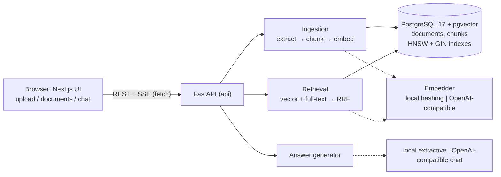

# DocuChat

Ask questions about your own documents and get answers that cite their sources.

DocuChat is a retrieval-augmented generation (RAG) app. Upload PDF, Markdown or text files; they are split into
overlapping chunks, embedded, and stored in PostgreSQL with pgvector. A question is answered by running **vector
search and PostgreSQL full-text search in parallel, fusing the two rankings with Reciprocal Rank Fusion (RRF)**,
and generating an answer from the best passages. Every answer carries citations (file, chunk, page), and the API
**refuses to answer** when retrieval confidence is too low instead of guessing.

It runs **fully offline** by default (deterministic hashing embeddings + an extractive answerer that quotes the
retrieved passages) and switches to any **OpenAI-compatible API** (OpenAI, Ollama, vLLM, LM Studio, ...) with
environment variables.

## Features

- Upload PDF / Markdown / TXT (`POST /documents`), with SHA-256 content-hash dedupe (identical re-uploads return
  the existing document; concurrent duplicate uploads are resolved by a `UNIQUE` constraint).
- Text extraction (pypdf, page-aware), chunking with configurable size/overlap that never crosses a page boundary.
- Hybrid retrieval: pgvector cosine search (HNSW index) + `tsvector` full-text search (GIN index), fused with RRF.
- Refusal: answers only if the best chunk is similar enough **or** covers enough of the question's terms.
- Answers stream over Server-Sent Events (`POST /ask` with `"stream": true`) or return as JSON.
- Provider interface: offline `local` providers or `openai` providers, chosen per env var; chunks remember which
  embedding model produced them, and search never compares vectors from different models.
- Next.js (App Router, TypeScript, Tailwind) UI: upload page, document list with delete, chat page with streamed
  answers and clickable `[n]` citations that open the cited passage.
- Retrieval evaluation script: hit@k and MRR for vector-only vs full-text-only vs hybrid on a checked-in question
  set, plus a refusal-threshold sweep.
- Tests: 56 pytest tests (unit + API integration against real Postgres), SSE-parser tests for the web client,
  an end-to-end smoke script against the running Docker stack, and a GitHub Actions workflow running all of it.

## Architecture



What happens on `POST /ask`:

```mermaid
sequenceDiagram
    participant B as Browser
    participant A as API
    participant P as Postgres
    B->>A: POST /ask {question, top_k, stream: true}
    A->>A: embed(question)
    A->>P: top 30 by cosine distance (HNSW)
    A->>P: top 30 by ts_rank_cd (GIN, OR-query)
    A->>A: RRF fuse → top_k; compute confidence
    alt both confidence signals weak
        A-->>B: event: meta {refused: true}, token: refusal text, done
    else
        A-->>B: event: meta {citations, confidence}
        loop answer generation
            A-->>B: event: token {text}
        end
        A-->>B: event: done
    end
```

| Path | What it is |
|---|---|
| `backend/app/main.py` | HTTP API (FastAPI app factory, request/response models, SSE) |
| `backend/app/ingestion/` | `extract.py` (PDF/MD/TXT → pages), `chunking.py`, `service.py` (upload pipeline) |
| `backend/app/retrieval.py` | hybrid search, RRF, confidence/refusal rule |
| `backend/app/qa.py` | retrieve → decide → generate, builds citations |
| `backend/app/providers/` | `Embedder` / `AnswerGenerator` protocols, local and OpenAI-compatible implementations |
| `backend/app/repository.py` | all SQL |
| `backend/migrations/` | plain SQL migrations, applied by `python -m app.db` at container start |
| `backend/eval/` | eval question set, eval runner, sample-PDF builder |
| `web/` | Next.js frontend (`app/` pages, `lib/api.ts` client, `lib/sse.ts` stream parser) |
| `sample_docs/` | four sample documents written for this repo (fictional handbook, Postgres notes, Raft notes, 3-page PDF) |
| `scripts/` | `e2e_smoke.py` (end-to-end check), `bench_ask.py` (latency) |

## Quick start (Docker, offline)

```bash
docker compose up -d --build --wait     # db :5433, api :8000, web :3000
open http://localhost:3000              # upload files from sample_docs/, then ask
python3 scripts/e2e_smoke.py            # optional: scripted end-to-end check
docker compose down                     # add -v to delete the database volume
```

Ports are configurable: `WEB_PORT=3010 API_PORT=8001 docker compose up -d --build --wait` (the web image bakes the
API URL in at build time, so rebuild after changing `API_PORT`). See `.env.example` for every variable.

### Using a real LLM / embedding model

```bash
EMBEDDING_PROVIDER=openai LLM_PROVIDER=openai OPENAI_API_KEY=sk-... docker compose up -d --build --wait
# or any OpenAI-compatible server, e.g. a local Ollama:
LLM_PROVIDER=openai OPENAI_BASE_URL=http://host.docker.internal:11434/v1 OPENAI_CHAT_MODEL=llama3.1 docker compose up -d
```

Vectors are stored as `vector(512)`, so the embedding model must accept the `dimensions` parameter (OpenAI
`text-embedding-3-*` do). Documents ingested with another embedder are not searched; delete and re-upload them.
`MIN_SIMILARITY` was tuned for the local embedder — re-run the eval sweep when you switch models. The OpenAI-compatible
path is covered by tests against an in-process fake HTTP server; it was not run against a paid API for this README.

## API

| Method | Path | Notes |
|---|---|---|
| `GET` | `/healthz` | DB check + active providers; 503 if the DB is down |
| `POST` | `/documents` | multipart `file`; 201 new, 200 duplicate (`"duplicate": true`), 422 unsupported/empty/unreadable |
| `GET` | `/documents` | newest first, with chunk counts |
| `DELETE` | `/documents/{id}` | 204; chunks are removed by `ON DELETE CASCADE`; 404 if unknown |
| `POST` | `/ask` | `{"question": str, "top_k": 1-20, "stream": bool}` |

```bash
curl -F file=@sample_docs/raft-consensus.txt localhost:8000/documents
curl -s localhost:8000/ask -H 'content-type: application/json' \
     -d '{"question": "How does Raft avoid split votes?", "top_k": 3}'
curl -N localhost:8000/ask -H 'content-type: application/json' \
     -d '{"question": "How does Raft avoid split votes?", "stream": true}'   # SSE: meta, token..., done
```

Non-streaming response shape: `{answer, refused, confidence: {similarity, term_coverage}, citations: [{marker,
document_id, filename, chunk_index, page, text, score, similarity}]}`. Interactive docs at
`http://localhost:8000/docs`.

## Local development

```bash
docker compose up -d db                                  # Postgres + pgvector on localhost:5433

cd backend
python3.13 -m venv .venv && .venv/bin/pip install -r requirements-dev.txt
.venv/bin/python -m app.db                               # apply migrations
.venv/bin/uvicorn app.main:create_app --factory --reload # http://localhost:8000

cd ../web
npm ci && npm run dev                                    # http://localhost:3000
```

## Testing

```bash
cd backend
REQUIRE_DB=1 .venv/bin/pytest --cov      # 56 tests; needs the compose db (else DB tests skip, or fail with REQUIRE_DB=1)
.venv/bin/ruff check . && .venv/bin/ruff format --check .

cd ../web
npm run lint && npm run typecheck && npm test && npm run build

cd .. && python3 scripts/e2e_smoke.py   # against the running compose stack
```

Each integration test runs in its own throwaway Postgres schema (`search_path` per connection), so tests never touch
your data and can run against the same database as the app.

Measured on this machine (MacBook Air, Apple silicon, macOS, Docker Desktop), 2026-10-31:

- `REQUIRE_DB=1 .venv/bin/pytest --cov` → **56 passed**, line coverage of `app/` **96%**.
- `npm test` → 3 passed; `npm run build` → succeeds (4 static routes).
- `python3 scripts/e2e_smoke.py` against `docker compose up` → all 18 checks pass (health, 4 uploads, dedupe,
  list, cited answer, PDF page citation, SSE stream, refusal, 3 web pages, deletes).

## Evaluation

`backend/eval/dataset.json` has 49 questions over `sample_docs/`: 41 answerable (each names the source file and an
evidence string that the relevant chunk must contain — robust to changing chunk size) and 8 that the corpus cannot
answer. The runner ingests the samples into a temporary schema, then for each mode retrieves the top 10 chunks.

```bash
docker compose up -d db
cd backend && .venv/bin/python -m eval.run_eval      # add --json for machine-readable output
```

Result (local hashing embedder, chunk size 800 / overlap 150 → 28 chunks):

| mode | hit@1 | hit@3 | hit@5 | MRR@10 |
|---|---|---|---|---|
| vector only | 0.756 | 0.878 | 0.951 | 0.830 |
| full-text only | 0.659 | 0.927 | 1.000 | 0.809 |
| **hybrid (RRF)** | **0.780** | **0.951** | **1.000** | **0.873** |

Refusal on the same questions (hybrid, top 5):

| rule | answered (of 41 answerable) | refused (of 8 unanswerable) |
|---|---|---|
| similarity ≥ 0.18 only | 78.0% | 100% |
| term coverage ≥ 0.5 only | 87.8% | 100% |
| **similarity ≥ 0.18 OR coverage ≥ 0.5 (default)** | **90.2%** | **100%** |
| similarity ≥ 0.14 OR coverage ≥ 0.5 | 92.7% | 87.5% |

Read these honestly: the corpus is 4 short documents and 49 questions that I wrote, and the thresholds were picked
on this same set (no held-out split), so they show that the pipeline and the fusion work as designed, not how it
would score on your documents. Hybrid beating either retriever alone is the expected RRF behaviour: the two
retrievers make different mistakes.

## Performance

```bash
python3 scripts/bench_ask.py --rounds 5     # stack running; 245 sequential non-streaming /ask calls
```

On this machine with the 4 sample documents (28 chunks) loaded and local providers, five warm runs measured p50
**2.0–2.1 ms** and p95 **2.4–2.5 ms** per `/ask` request; one run started right after rebuilding the containers
measured p50 5.5 ms / p95 8.4 ms (cold caches, other builds running). This only shows the request path adds little
overhead; with a real LLM the generation call dominates, and with a large corpus the HNSW/GIN lookups would.

## Design decisions

- **Postgres for everything.** pgvector keeps vectors next to the text, metadata and full-text index, so a document
  and its chunks are written in one transaction and deleted with one cascade. No second datastore to keep in sync.
- **Hybrid retrieval with RRF.** Embeddings match paraphrases; full-text matches exact names, numbers and rare terms.
  RRF combines them using only ranks (`1/(k + rank)`, k = 60), so cosine similarities and `ts_rank` scores never
  need to be normalised onto one scale.
- **Full-text uses an OR query.** `plainto_tsquery` ANDs all words, which makes most natural-language questions
  match nothing; the query is rewritten to OR the lexemes and `ts_rank_cd` does the ranking.
- **Refusal uses absolute signals, not RRF scores.** RRF always produces a "best" result, even for nonsense. The
  API refuses when the best cosine similarity is low *and* no chunk contains at least half of the question's
  content words.
- **Provider protocols + offline defaults.** `Embedder` and `AnswerGenerator` are small protocols. The offline
  pair makes the app, tests, CI and eval deterministic and free; the extractive answerer only quotes retrieved
  sentences, so it cannot invent facts.
- **Model-tagged vectors.** Each document stores `embedding_model`; search filters on it, because vectors from two
  models are not comparable.
- **Dedupe before work.** Hashing the upload first skips extraction and embedding for re-uploads; the `UNIQUE`
  constraint plus `ON CONFLICT DO NOTHING` makes concurrent duplicate uploads safe without locks.
- **Plain SQL migrations** with an advisory lock, instead of an ORM: the schema (generated `tsvector` column,
  HNSW/GIN indexes) is visible in one file.
- **Synchronous FastAPI handlers + psycopg pool.** FastAPI runs `def` handlers in a thread pool; simpler than async
  DB code and adequate here.

## Limitations

- The offline embedder is lexical (hashed words, word pairs, character trigrams), not semantic: it will not match
  "car" with "automobile". Use an OpenAI-compatible embedding model for semantic retrieval.
- Short questions whose only content word is rare can be refused (e.g. "How do I get rid of aphids?" scores
  similarity 0.076 and 33% coverage and is refused even though the PDF covers it).
- Scanned PDFs (images without a text layer) are rejected; there is no OCR. Only PDF/Markdown/TXT are supported.
- Uploads are processed synchronously in the request (fine for documents up to the 10 MB limit; a queue would be
  needed for large batches). No authentication or multi-tenancy: every user sees every document.
- The vector dimension is fixed at 512 by the migration.
- No conversation memory: each question is answered independently.

## License

MIT — see [LICENSE](LICENSE).
